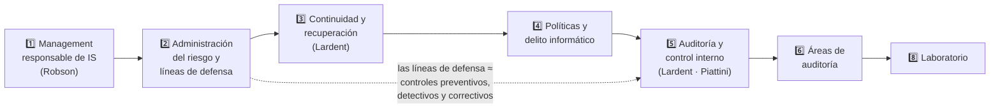

# 🏠 U6 — Seguridad y Auditoría de los SI/TI

> [!info] Cómo usar esta wiki
> Cada concepto es una nota atómica conectada por wikilinks. Empezá por acá, seguí los links y usá el **Graph View** filtrando por `tag:#ASI-U6`. La carpeta **99 Examen** tiene el [[Cuestionario U6 (11 preguntas)|cuestionario]] con cada pregunta linkeada a su respuesta, las [[Preguntas de final U6|preguntas de final]] y los [[Comodines y cruces de examen U6|comodines]]. Para leer todo de corrido: [[ASI U6 - Seguridad y Auditoría de SI-TI (Súper Resumen)|Súper Resumen U6]].

## 🧭 Recorrido sugerido

## 1️⃣ Management responsable de IS (Robson T5 Cap. 13)
- [[Control del ambiente informático]]
- [[Management responsable de IS]] — técnico · ético · legal
- [[Pérdida de seguridad]] — integridad · disponibilidad · confidencialidad

## 2️⃣ Seguridad y administración del riesgo
- [[Administración del riesgo]] — qué es y sus 4 etapas
  - [[Identificación del riesgo]] · [[Amenaza, vulnerabilidad y riesgo (definiciones)]]
  - [[Análisis del riesgo]] · [[Tabla de pérdida anual (ALE)]] · [[Consecuencias primarias y secundarias]]
  - [[Manejo del riesgo (4 estrategias)]]
- [[Controles y contramedidas]] · [[Líneas de defensa]] · [[Controles y contramedidas específicos (Robson)]]

## 3️⃣ Continuidad y recuperación ante desastres
- [[Recuperación ante el desastre]] (Robson)
- [[Plan de contingencias]] (Lardent) · [[Niveles de emergencia (catástrofe, desastre y no desastre)]] · [[Hardware alternativo y sitios de respaldo]]
- [[Metodologías de recuperación]] · [[Auditoría de la continuidad de las operaciones]]

## 4️⃣ Políticas de seguridad y delitos informáticos
- [[Políticas de seguridad]] · [[Jerarquía normativa de seguridad (política, estándar, mejor práctica, guía y procedimiento)]] · [[Ciclo de vida de una política de seguridad]]
- [[Delito informático]] · [[Tipos de ataques contra los SI]] · [[Artífices y modalidades del delito informático]]

## 5️⃣ Auditoría y control interno (Lardent · Piattini & Del Peso)
- [[Auditoría — concepto y tipos]] · [[Auditoría de sistemas de información]]
- [[Control interno]] · [[Control interno informático (Piattini)]] · [[Auditoría informática vs control interno informático]]
- [[Auditoría interna y externa]] · [[Deontología del auditor]]
- [[Etapas de la auditoría (plan y programa de revisión)]] · [[Riesgos de auditoría (inherente, de control y de detección)]]
- [[Procedimientos y evidencia de auditoría]] · [[Tipos de pruebas de auditoría]] · [[Informe de auditoría]]
- [[Objetos y áreas de la auditoría de SI]]

## 6️⃣ Áreas de auditoría
- [[Auditoría de la función informática]] · [[Separación de funciones]]
- [[Auditoría del desarrollo de sistemas]] · [[Auditoría del desarrollo — Lardent vs Piattini]]
- [[Auditoría de sistemas de aplicación instalados]]
- [[Auditoría de seguridad]]
- [[Otras áreas de auditoría (Extras del apunte)]]

## 7️⃣ Conceptos complementarios
- [[Glosario U6]] · [[Autores y modelos clave U6]] · [[Diferencias que se confunden U6]]

## 8️⃣ Laboratorio
- [[Guía del laboratorio U6 (líneas de defensa sobre análisis de riesgo)]]

## 🎓 Examen
- [[Cuestionario U6 (11 preguntas)]] · [[Preguntas U6|Checklist]]
- [[Preguntas de final U6]] · [[Comodines y cruces de examen U6]]
- [[Bibliografía U6]] · [[Índice alfabético U6]]
