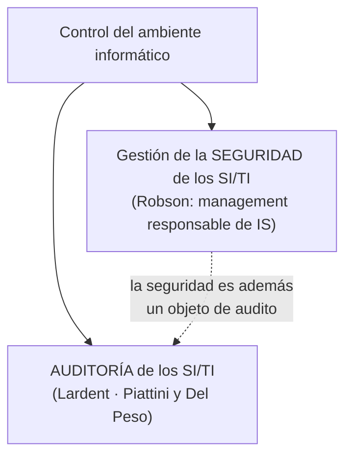

# Control del ambiente informático

> [!quote] Definición (apunte sistematizado)
> El control del ambiente informático es el **conjunto conformado por la seguridad, la auditoría y los controles** aplicados sobre el **área de SI y sus recursos**, así como sobre **todos los sectores asociados al procesamiento de información** de la organización.

**En criollo:** no se controla solo "el departamento de sistemas": se controla todo lugar donde se procese información, aunque sea en papel.

## ¿Qué abarca el ambiente informático?
No solo el departamento de procesamiento de datos, sino también todos los sectores asociados con él porque:
- le **proveen datos** para procesar,
- son **usuarios** de la información procesada, o
- **procesan información localmente** y proveen datos de resumen al procesador central.

> [!example] Ejemplo
> En un banco, el ambiente informático incluye el centro de cómputos, pero también las sucursales que cargan operaciones (proveen datos), la gerencia que usa los reportes (usuaria) y el área de riesgo que procesa planillas propias y envía resúmenes al sistema central.

## ¿Por qué se controla?
1. Como **medida de prevención de riesgos**, para evitar posibles pérdidas para la organización.
2. Para controlar que todas las actividades se efectúen **de acuerdo con los procedimientos y normas fijados**.
3. Para **comprobar que se logren los niveles de servicio adecuados**.

## Los procesos de control
Son las herramientas que garantizan que las tecnologías y las áreas relacionadas con el procesamiento de la información funcionen adecuadamente. Son **dos**:

> [!info] Dos metodologías de evaluación distintas
> Según el *Apunte Supremo* (resumen de alumnos), las dos metodologías de evaluación de sistemas "por antonomasia" son el **análisis de riesgos** y la **auditoría informática**: la auditoría **identifica el nivel de "exposición"** por falta de controles, mientras que el análisis de riesgos **evalúa los riesgos y recomienda acciones** en base al costo-beneficio.

## 🔗 Relacionado
- [[Management responsable de IS]] · [[Administración del riesgo]] · [[Auditoría de sistemas de información]] · [[Control interno]]
- [[00 Home — U6 Seguridad y auditoría|🏠 Home U6]]
