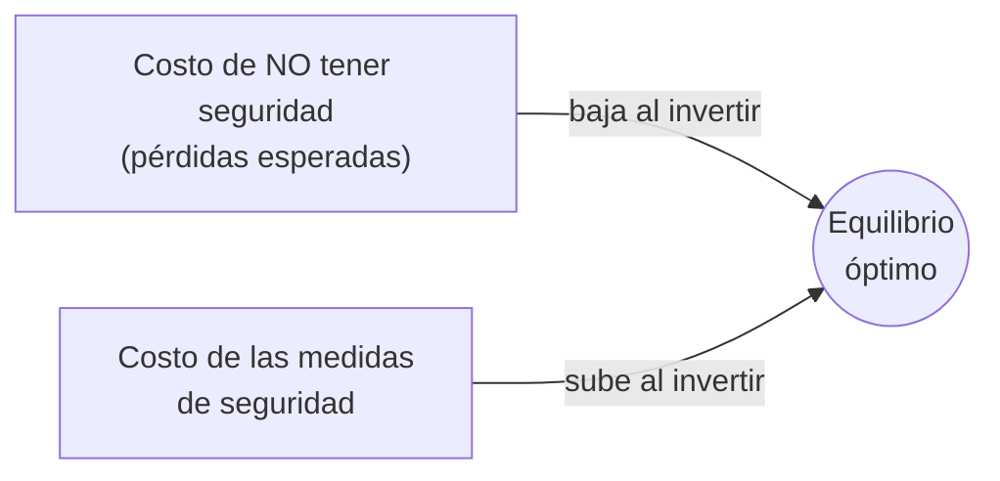
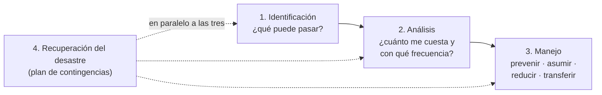

# Administración del riesgo (management del riesgo)

## ¿Qué es? (I.3)
De la definición de [[Pérdida de seguridad]] "se desprende la noción de que las organizaciones necesitan **administrar el riesgo de exposición** de cada uno de los elementos de los IS. Este management deberá considerar el **equilibrio entre los costos resultantes de una falla en la seguridad y los costos resultantes de las medidas necesarias para aumentar la seguridad**. El punto central es identificar el **equilibrio óptimo**" (Robson).

> [!quote] Robson
> "El costo de tener seguridad queda relativamente claro de antemano, mientras que el costo de no tener seguridad puede ser difícil de definir, aun cuando las fallas ocurran. **El management del riesgo intenta reducir estas pérdidas.** Un enfoque sistemático del management del riesgo permitirá que [la seguridad de] los IS sea administrada de tal forma que reconozca la **vulnerabilidad y la sensibilidad** de los sistemas de la empresa y los datos que éstos contienen, pero también los **costos, en términos sociales, financieros y técnicos, de los controles** y las medidas para el manejo del riesgo. **Ningún sistema puede ser completamente seguro.** El management sistemático permite elegir e implementar las contra medidas de una forma **planeada y administrada, y no sobre una base ad hoc**."

Cualquier cambio en la importancia relativa de los elementos del portfolio de IS o del entorno empresarial **obliga a revisar** el enfoque, porque mueve el punto de equilibrio.

## ¿Cómo se relaciona con la seguridad?
> [!important] Idea clave
> **No se administra la seguridad en sí, sino el nivel de riesgo**: cuanto menor es el nivel de riesgo, mayor es la seguridad.

Premisas (apunte sistematizado):
- **La seguridad total es imposible**: nunca se alcanza el 100 %; solo un **nivel razonable**.
- **Mejor manejo del riesgo**: buscar el equilibrio entre el costo de una falla y el costo de las medidas.

**En criollo:** como no puedo blindar todo, la administración del riesgo es **el mecanismo** que me dice cuánto gastar y dónde, para llegar a un nivel de seguridad razonable al menor costo.

## Etapas de la administración del riesgo (I.4)
"Cualquiera sea la metodología que se siga, el management de la seguridad de los IS se reduce a **cuatro etapas**" (Robson):

| # | Etapa | Síntesis (Robson) | Nota |
|---|---|---|---|
| 1 | **Identificación del riesgo** | La organización busca identificar **todos** los riesgos a los que está potencialmente expuesta | [[Identificación del riesgo]] |
| 2 | **Análisis del riesgo** | **Cuantificar la probabilidad y la frecuencia** esperada de ocurrencia de cada riesgo y evaluar la **gravedad de las consecuencias** | [[Análisis del riesgo]] |
| 3 | **Manejo del riesgo** | Con el patrón de exposición identificado y analizado, **seleccionar controles y contramedidas** para alcanzar la posición de seguridad óptima | [[Manejo del riesgo (4 estrategias)]] |
| 4 | **Recuperación del desastre** | Como ningún proceso de seguridad puede ser absoluto, **en paralelo a las otras tres** debe existir una **planificación de contingencias**; el plan se controla, revisa y pone a prueba en forma continua | [[Recuperación ante el desastre]] |

## Metodologías de management del riesgo (Robson)
- **CRAMM** (Metodología de análisis y management del riesgo, producida por la CCTA y aprobada por el gobierno británico): probablemente la más utilizada; identificación y análisis sistemático + enumeración de contramedidas recomendadas; usa **cuestionarios** y software que formula recomendaciones. Desventaja: **consume demasiado tiempo**.
- **RiskPAC** (paquete norteamericano basado en PC), **MARION** (equivalente francés), **SRA** (Análisis de riesgo estructurado, Reino Unido).
- Todas hacen un **modelo de amenazas y consecuencias** para calcular la gravedad del riesgo y equilibrarla con el costo de las contramedidas. Muchas usan análisis **cualitativo**; las más formales intentan uno **cuantitativo**.

**Cuestionario:** responde la **I.3** y la **I.4**.

## 🔗 Relacionado
- [[Pérdida de seguridad]] · [[Amenaza, vulnerabilidad y riesgo (definiciones)]] · [[Tabla de pérdida anual (ALE)]] · [[Líneas de defensa]] · [[Políticas de seguridad]]
- [[Guía del laboratorio U6 (líneas de defensa sobre análisis de riesgo)]]
