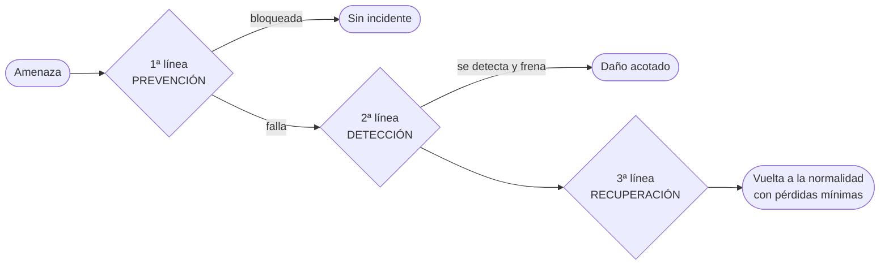

# Líneas de defensa (prevención · detección · recuperación)

"Aun dentro de cada capa de control existen **diferentes intenciones** relacionadas con cada medida específica. La intención puede ser la de **prevenir, detectar o reducir el impacto** de las amenazas anticipadas" (Robson, Fig. 13.13 "Tres etapas de controles y contra medidas").

| Línea | Etapa | Qué busca | Ejemplo (Robson) | Equivalente en control interno (Lardent) |
|---|---|---|---|---|
| **1ª línea de defensa** | **Prevención** | Prevenir las amenazas, **evitar que ocurran** | **Prohibir que se fume** en el centro de datos; [[Políticas de seguridad\|políticas de seguridad]] | Control **preventivo** |
| **2ª línea de defensa** | **Detección** | Detectar fallas de seguridad **a pesar de la primera línea** ("si falla la primera línea, es decir, si ocurre el ataque, debo detectarlo") | Un **detector de humo**; registro de ingresos fallidos | Control **detectivo / de detección** |
| **3ª línea de defensa** | **Recuperación** | **Recuperarse** de una falla de seguridad **con pérdidas mínimas** ("volver al estado anterior a la amenaza") | **Backups de datos off-site** | Control **correctivo** |

> [!example] Una sola herramienta, tres líneas (Robson)
> El **software de autorización** puede **prevenir** el uso no autorizado, también **registrar los ingresos fallidos** para **detectar** ataques, y luego usar la **encriptación** para **minimizar el daño** causado por una entrada ilegal. Lo mismo con los **antivirus**: monitoreo (prevenir), escaneo (detectar), backups (eliminar efectos / recuperar).

> [!important] Dónde actúan
> Las tres etapas se aplican a la mayoría de las capas de control y **bloquean los efectos de la amenaza** en cada eslabón: entre el evento y el daño a los sistemas, entre el daño y las pérdidas directas, y entre éstas y las pérdidas secundarias (Fig. 13.14). Por eso Robson insiste: "los objetivos de las medidas de seguridad son la **prevención, la detección y la recuperación**, y deberían aplicarse a **cada uno de los elementos** de la red".

## ¿Qué son las líneas de defensa? (respuesta de final)
Son los **controles y contramedidas** con los que se implementan las estrategias de manejo del riesgo para **evitar, reducir o transferir** el impacto del riesgo, organizados según su **intención** (prevenir, detectar, recuperar). En criollo: barreras sucesivas; si una falla, actúa la siguiente.

## Relación con la recuperación ante el desastre
La tercera línea (recuperación) se apoya en la **planificación de contingencias**: [[Plan de contingencias]] y [[Recuperación ante el desastre]]. Bolton (1992), citando a Lloyds, pide como "obvio" antes de asegurar: **defensas y detectores físicos de primera línea**, backups en un lugar separado, hardware de respaldo, contratos de mantenimiento, reglas de desarrollo y aceptación de software, buenos procedimientos del personal.

## 🔗 Relacionado
- [[Controles y contramedidas]] · [[Control interno]] · [[Políticas de seguridad]] · [[Guía del laboratorio U6 (líneas de defensa sobre análisis de riesgo)]]
