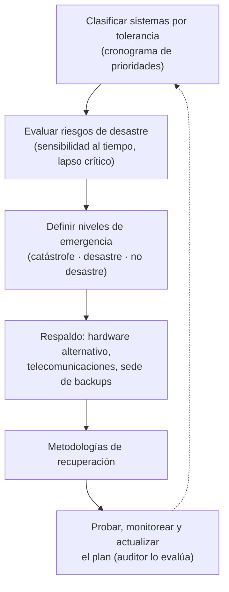

# Plan de contingencias (Lardent)

> [!quote] Definición (apunte, según Lardent)
> Formular un plan de contingencias consiste en **definir los planes que permitan a la empresa sobrevivir a algún tipo de desastre y los procesos que permitan la recuperación**. Se debe prever: el **tiempo de inhabilitación**, el **respaldo o mantenimiento**, la **reinstalación** y la **tolerancia del sistema**.

**Responsable:** la formulación del plan es responsabilidad de la **gerencia superior**.

## Evaluación de riesgos (para el plan)
- Interesan los riesgos vinculados con la **probabilidad de que se presente un desastre**: "todo suceso sujeto a cierto grado de incertidumbre en cuanto a su ocurrencia, pero que, cuando ocurre, puede **interrumpir o afectar seriamente la operación normal** de un negocio".
- Se clasifican para priorizar según la **sensibilidad al tiempo** (tiempo necesario para que se reanude el negocio).
- Se considera la **tolerancia del sistema**: su capacidad para enfrentar una interrupción; puede expresarse como **valor monetario**.
- **Lapso crítico de recuperación:** período hasta el que puede extenderse una interrupción **antes de que se presente el riesgo de incurrir en pérdidas**; lo condiciona la naturaleza del negocio y de los sistemas.

## Situaciones de interrupción
Tres niveles: **catástrofe, desastre, no desastre** → [[Niveles de emergencia (catástrofe, desastre y no desastre)]].

## Contenido del plan de contingencias
1. **Orden de prioridades para la recuperación** de aplicaciones, software de base y archivos de datos, **según el grado de tolerancia**.
2. **Orden de procesamiento de las tareas complejas.**
3. **Mecanismos de acoplamiento manual** durante interrupciones cortas.
4. Considerar **los equipos de todo el ambiente informático**, no solo las unidades centrales (sedes remotas); **personal entrenado**.
5. **Disponibilidad de hardware alternativo:** centro duplicado propio o centros de terceros (**hot, warm, cold sites**) → [[Hardware alternativo y sitios de respaldo]].
6. **Disponibilidad de la capacidad de telecomunicaciones:** **rutas alternativas** (cuando se interrumpe la red normal) y **rutas diversificadas** (alternativas en un lugar físico distinto).
7. **Sede alternativa para el almacenamiento** de los medios magnéticos (backups) y de la **documentación**.

> [!tip] Dicho en clase (Soria)
> Al contenido del plan la profesora **agregó la disponibilidad de las telecomunicaciones y de las redes de energía**.

## Qué debe hacer el plan en la emergencia
Seguir las [[Metodologías de recuperación|metodologías de recuperación]] (primero: **protección de la vida humana**).

## Cómo lo revisa el auditor
→ [[Auditoría de la continuidad de las operaciones]]. La auditoría de sistemas revisa que el plan de contingencias **exista y sea coherente con los objetivos propuestos**.

## 🔗 Relacionado
- [[Recuperación ante el desastre]] · [[Administración del riesgo]] · [[Líneas de defensa]] · [[Auditoría de seguridad]]
