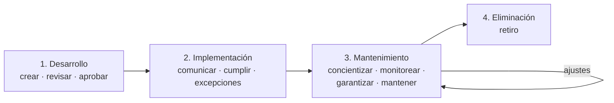

# Ciclo de vida de una política de seguridad

| Fase | Pasos |
|---|---|
| **1. Desarrollo** | **Creación** (planificar, investigar y redactar; identificar la necesidad, alcance y aplicabilidad) → **Revisión** (independiente, por otro grupo o persona) → **Aprobación** (apoyo de la administración; habilita la implementación) |
| **2. Implementación** | **Comunicación** (difundir y concientizar) → **Cumplimiento** (seguimiento) → **Excepciones** (no todo puede cumplirse como se planteó; se **documentan**) |
| **3. Mantenimiento** | **Concientización** (trabajo continuo) · **Monitoreo** (seguir e informar su efectividad) · **Garantía de cumplimiento** (identificar incumplimientos, analizar causas, evitar que se repitan) · **Mantenimiento** (la política es **contingente**: se ajusta) |
| **4. Eliminación** | **Retiro** cuando cumplió su finalidad y ya no es necesaria (p. ej., por grandes avances tecnológicos) |

> [!tip] Para recordar
> **D-I-M-E**: Desarrollo, Implementación, Mantenimiento, Eliminación. El "monitoreo" de la fase 3 conecta con el seguimiento/monitoreo de recursos de la U3 y con la auditoría (que verifica el cumplimiento).

## 🔗 Relacionado
- [[Políticas de seguridad]] · [[Jerarquía normativa de seguridad (política, estándar, mejor práctica, guía y procedimiento)]]
