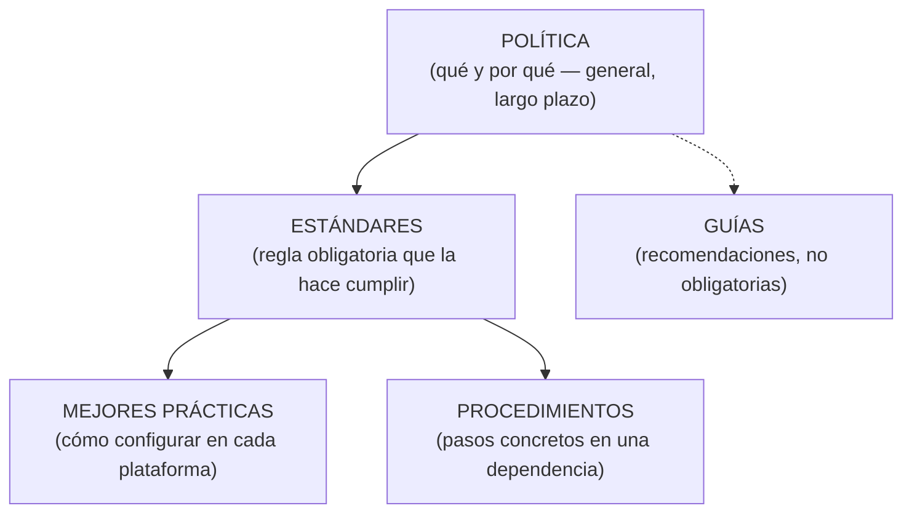

# Política, estándar, mejor práctica, guía y procedimiento

| Instrumento | Definición (apunte de la profesora) | ¿Obligatorio? |
|---|---|---|
| **Política** | **Declaración general de principios** que presenta la posición de la administración para un área de control definida. Aplicación **a largo plazo**; guía el desarrollo de reglas más específicas. Deben ser **pocas**, **aprobadas por las autoridades** y orientar a toda la organización o a un conjunto importante de dependencias | **Sí, por definición.** No cumplirla exige aprobar una **excepción** |
| **Estándar** | **Regla que especifica una acción o respuesta** ante una situación dada. Son **especificaciones para implementar las políticas** (no crean políticas nuevas) | **Sí** (orientaciones obligatorias) |
| **Mejor práctica** | **Regla de seguridad específica de una plataforma**, aceptada en la industria como el enfoque más efectivo; asegura configuración y administración **uniformes** | Se adopta para garantizar un nivel consistente |
| **Guía** | **Declaración general para recomendar o sugerir** un enfoque de implementación de políticas, estándares y buenas prácticas | **No**, pero se siguen salvo argumentos documentados y aprobados |
| **Procedimiento** | Define **específicamente cómo** se implementan políticas, estándares, mejores prácticas y guías **en una situación dada**; depende de la tecnología o del proceso. Lo desarrolla, implementa y supervisa el **dueño del proceso o sistema** | Sigue lo más fielmente posible a los anteriores |

> [!example] Ejemplo completo (correo confidencial)
> - **Política:** "garantizar la seguridad del correo electrónico cuyo contenido sea información confidencial".
> - **Estándar:** esos mensajes se envían con un sistema de **criptografía aprobado** y se **borran de manera segura** después del envío.
> - **Mejor práctica:** cómo **configurar el correo** en un sistema específico (Windows o Linux) para cumplir política y estándar.
> - **Procedimiento:** requisitos para aplicarlos en una dependencia concreta (p. ej., la **Oficina de Control Interno**).
> - **Guía:** técnicas, configuraciones y secuencias de comandos **recomendadas** a los usuarios.

> [!note] Ejemplo de origen universitario
> El texto del apunte habla de "autoridades de la universidad" porque proviene de una política institucional universitaria; generalizalo a "la dirección de la organización".

## 🔗 Relacionado
- [[Políticas de seguridad]] · [[Ciclo de vida de una política de seguridad]] · [[Control interno informático (Piattini)]] (la Dirección de Informática publica procedimientos, estándares y normas)
