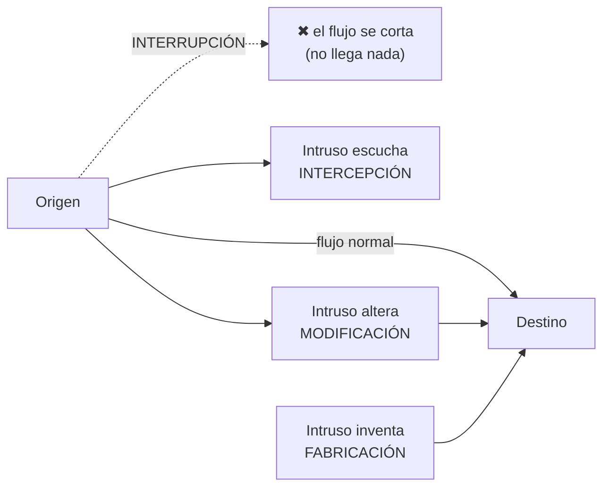

# Clasificación y tipos de ataques contra los SI

"**Un ataque no es más que la realización de una amenaza.**"

## Las cuatro categorías generales

| Categoría | Qué pasa | Ataca a | Ejemplos |
|---|---|---|---|
| **Interrupción** | Un recurso es **destruido o deja de estar disponible** | **Disponibilidad** | Destruir un disco duro, cortar una línea de comunicación, inhabilitar el sistema de gestión de ficheros |
| **Intercepción** | Una entidad no autorizada (persona, programa u ordenador) **consigue acceder** a un recurso | **Confidencialidad** | Pinchar una línea; copia ilícita de ficheros o programas (**intercepción de datos**); leer cabeceras de paquetes para desvelar quién se comunica (**intercepción de identidad**) |
| **Modificación** | La entidad no autorizada accede **y además manipula** el recurso | **Integridad** | Cambiar valores en un archivo, alterar un programa, modificar mensajes en tránsito |
| **Fabricación** | La entidad no autorizada **inserta objetos falsificados** | **Autenticidad** | Insertar mensajes espurios en una red, agregar registros a un archivo |

## Pasivos vs activos

| | **Ataques PASIVOS** | **Ataques ACTIVOS** |
|---|---|---|
| Qué hace el atacante | **No altera** la comunicación: solo **escucha o monitoriza** | **Modifica** el flujo de datos o **crea un flujo falso** |
| Objetivos | **Intercepción de datos** y **análisis de tráfico** | Suplantación, reactuación, modificación, degradación |
| Detección | **Muy difíciles de detectar** (no alteran datos) | Más detectables |
| Defensa | Evitar su éxito con **cifrado** y otros mecanismos | Controles de autenticación, integridad, disponibilidad |

### Las cuatro categorías de ataques activos
1. **Suplantación de identidad:** el intruso **se hace pasar por otra entidad** (suele incluir otras formas de ataque activo). Ej.: capturar y repetir secuencias de autenticación; robar la contraseña de una cuenta.
2. **Reactuación:** mensajes legítimos **capturados y repetidos** para producir un efecto no deseado. Ej.: ingresar dinero repetidas veces en una cuenta.
3. **Modificación de mensajes:** se altera una porción del mensaje, o se **retarda o reordena**. Ej.: "Ingresa un millón de pesos en la cuenta A" → "…en la cuenta B".
4. **Degradación fraudulenta del servicio:** impide o inhibe el uso normal o la gestión de los recursos. Ej.: suprimir los mensajes dirigidos a una entidad o **inundar la red con mensajes espurios**.

> [!tip] Cruce rápido con la pérdida de seguridad
> Interrupción → **disponibilidad** · Intercepción → **confidencialidad** · Modificación → **integridad** · Fabricación → **autenticidad**. Los tres primeros son exactamente los tres aspectos de la [[Pérdida de seguridad]] de Robson; la autenticidad es uno de los seis elementos que toda [[Políticas de seguridad|política]] debe contemplar.

## 🔗 Relacionado
- [[Delito informático]] · [[Artífices y modalidades del delito informático]] · [[Amenaza, vulnerabilidad y riesgo (definiciones)]]
