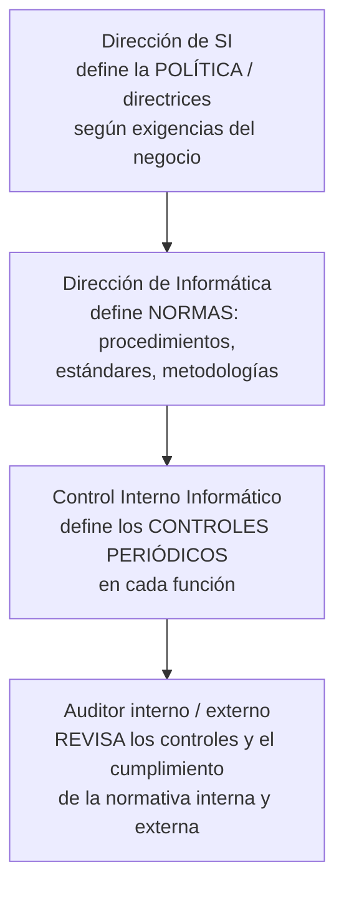

# Control interno informático — CII (Piattini & Del Peso)

> [!quote] Definición como unidad organizativa (Piattini, según el apunte)
> Es el **departamento, dirección, etc.**, que se crea para **controlar diariamente** que todas las actividades de los SI/TI se realicen **cumpliendo los procedimientos, estándares y normas** fijados por la dirección de la organización o por la dirección informática, así como los **requerimientos legales**.

- **Misión:** asegurarse de que las **medidas implementadas por cada responsable sean correctas y válidas** (que se estén cumpliendo). "Es no solo ver que se cumple, sino ver que **lo que se está cumpliendo es lo adecuado**" (Apunte Supremo).
- **En criollo:** es "el control de todos los días" dentro de sistemas; el auditor viene después y le pide sus registros.

## Objetivos
1. **Colaborar con las auditorías informáticas**, internas y externas (el CII les provee el **principal insumo**).
2. **Controlar** que todas las actividades se efectúen según los procedimientos y normas fijados.
3. **Asesorar** sobre el conocimiento y la aplicación de las normas, y transmitirlas.
4. **Intervenir** en la definición, implementación y ejecución de mecanismos y controles para comprobar los **niveles de servicio** adecuados (no es responsabilidad exclusiva del CII).
5. Realizar el **control de actividades operativas** sobre los distintos SI y entornos:
   - cumplimiento de procedimientos, normas y controles (ej.: **cambios de versiones** de software);
   - controles sobre la **producción diaria**;
   - controles de **calidad y eficiencia en el desarrollo y mantenimiento** del software;
   - controles sobre **redes y software de base**;
   - controles sobre la **seguridad informática**;
   - controles sobre **licencias y relaciones contractuales** de los esquemas de **outsourcing**.

> [!example] Ejemplos de clase
> Controlar que los operarios **no se pasen las contraseñas**; un mecanismo que verifique que los **dispositivos del almacén se dejen en el lugar previsto**.

## Implantación de un sistema de control interno informático
**Paso 1 — conocer la configuración del sistema (el entorno):** documentar los detalles de la red y los niveles de control:
- **Entorno de red** · **Configuración del ordenador base** · **Entorno de aplicaciones** · **Productos y herramientas** (decidir qué herramienta se implementa **ya es una medida de control interno**) · **Seguridad del ordenador base**.

**Paso 2 — definir:**
| Elemento | Contenido |
|---|---|
| **Gestión de sistemas de información** | Políticas, pautas y normas técnicas para el diseño e implantación de los SI y sus controles |
| **Administración de sistemas** | Controles sobre la actividad de los **centros de datos** y funciones de apoyo, incluida la **administración de redes** (BD, accesos) |
| **Seguridad** | Las tres clases de controles fundamentales en el software del sistema: **integridad** del sistema, **confidencialidad** (control de acceso) y **disponibilidad** |
| **Gestión del cambio** | **Separación entre pruebas y producción** y control de la **migración de programas aprobados y probados**. Garantiza que **el diseño original se mantiene** y los cambios no afectan su esencia; "la medida de control interno es **cómo se van autorizando los cambios**" — también es **fuente para la auditoría** |

## Quién hace qué (la cultura de seguridad se implanta por fases, con respaldo de la Dirección)

> [!important] Responsabilidad
> "La **creación de un sistema de control informático es una responsabilidad de la Gerencia** y un punto destacable de la política del entorno informático."

## 🔗 Relacionado
- [[Control interno]] · [[Auditoría informática vs control interno informático]] · [[Jerarquía normativa de seguridad (política, estándar, mejor práctica, guía y procedimiento)]] · [[Explotación de sistemas]] (U3: la producción diaria que controla el CII)
