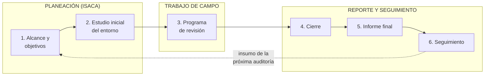

# Etapas de la auditoría: planificación, plan y programa de revisión

## Etapas genéricas de ISACA
1. **Planeación** — se relaciona con los dos primeros pasos del plan (a partir de la revisión inicial se planifica).
2. **Trabajo de campo y documentación** — aplicar lo planificado; **documentar las fuentes de evidencia**.
3. **Reporte y seguimiento** — cierre de la revisión, informe (primero la **opinión**, luego las **recomendaciones**) y verificación posterior.

## Los seis pasos del plan de auditoría (clase / apunte)
"En la materia no se ve una metodología específica de auditoría, pero es importante tener en cuenta":

| # | Paso | Qué implica |
|---|---|---|
| 1 | **Identificar el alcance y los objetivos** con respecto al objeto | **Alcance** = hasta dónde llega: qué entra y qué queda afuera. **Objetivos** = para qué se audita (¿hay degradaciones?, ¿se implementó hace poco?). Se describen los **objetos de audito** ("objeto" y "sujeto" de audito son sinónimos). Si es externa, quién la encarga. **No se puede empezar sin esto** |
| 2 | **Estudio inicial del entorno** a auditar | Arquitectura, distribución, **fuentes de evidencia**, interlocutores, si existe área de control interno; se identifican los **controles clave**. Sirve para **reducir el riesgo inherente** |
| 3 | **Ejecución del programa de revisión** | Acá entra la metodología específica; se desglosan alcance y objetivos en partes |
| 4 | **Cierre de la revisión** | Se reúnen los informes y se estudian las **evidencias y hallazgos** |
| 5 | **Informe final** | Opinión **favorable (razonablemente bien), con salvedades o con no conformidades**. **No hay auditoría sin informe final**, y requiere **firma** |
| 6 | **Seguimiento** | Verificar si se adoptaron las recomendaciones y **qué efectividad tuvieron**. Lo hace el auditor; insumo: los **reportes de auditorías anteriores** |

**Orden de las áreas a auditar:** se fijan **criterios y prioridades**, muy influidos por el **impacto en el negocio**, el **nivel de activos** controlados por el sistema, la **dimensión** de la aplicación y su **impacto en la toma de decisiones**.

## La planificación según Lardent
El auditor de SI debe considerar:
- **Conocimiento del negocio y su ambiente** (incluido el **ambiente normativo**): saber qué se va a revisar y sobre qué se va a opinar. Se obtiene **recorriendo las instalaciones**, **entrevistando** a gerentes usuarios y personal de sistemas, y **leyendo los planes estratégicos** y antecedentes.
- **Evidencia de auditoría y auditabilidad:** deben existir **fuentes verificables de evidencia** para probar los controles o realizar pruebas de sustanciación.

La planificación incluye: **determinar el área o aplicación** a auditar · **definir el objetivo** · **establecer el alcance** (sistemas, módulos, duración; no se puede auditar todo a la vez) · **planear los recursos**. Además, la **evaluación de riesgos globales** → [[Riesgos de auditoría (inherente, de control y de detección)]].

Terminada la planificación quedan definidos: tema y área, objetivo, alcance (uno o varios sistemas o un período), habilidades técnicas y recursos, y **fuentes de información** para las pruebas. El Apunte Supremo agrega que el punto de inicio es un **contrato de auditoría** que establezca los objetivos de la gerencia y delegue la autoridad.

## El programa de revisión
> [!quote] Definición (apunte)
> "El programa de auditoría es un **conjunto de instrucciones que guía a los auxiliares** involucrados en la auditoría y sirve como **medio para controlar y registrar la ejecución apropiada del trabajo**." Se prepara en la planeación, pero **es flexible**: puede modificarse según lo que se vaya observando (agregar, quitar, posponer).

1. **Deriva del plan de auditoría general.**
2. Se elabora **un programa por cada área** (sección) a auditar ("¿cuántos programas? tantos como áreas").
3. Detalla:
   - naturaleza, oportunidad y alcance de los **procedimientos**;
   - **objetivos** de auditoría de esa sección;
   - **fuentes de evidencia** (ej.: para auditar la organización del área: organigrama, políticas, manual del área);
   - **equipo de auditoría** (perfiles: seguridad, redes, infraestructura, derecho informático…);
   - **programa de trabajo específico**: para cada objetivo, pruebas, actividades, hitos, informes parciales, **tiempo estimado y real**, **referencia al papel de trabajo**, **rúbrica** de quien hizo cada paso y **fecha**; puntos a controlar con responsable, fecha de inicio y condición inicial;
   - **condiciones o situaciones que requieran tomar decisiones**.

## 🔗 Relacionado
- [[Procedimientos y evidencia de auditoría]] · [[Tipos de pruebas de auditoría]] · [[Informe de auditoría]] · [[Riesgos de auditoría (inherente, de control y de detección)]]
