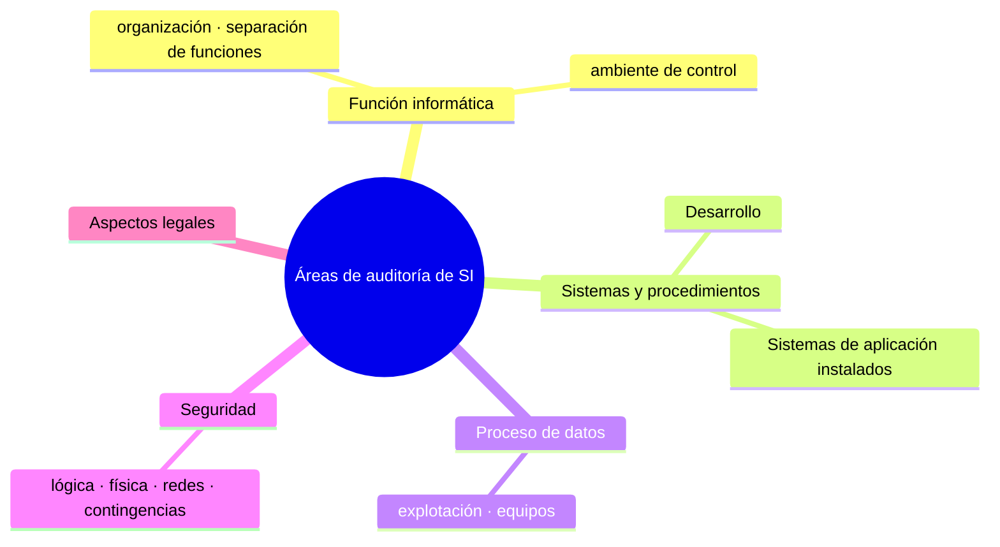

# Objetos (secciones) y áreas de la auditoría de SI (Lardent)

## Las cinco áreas
1. **Evaluación de la función informática** (organización y administración del ambiente informático: el área de sistemas) → [[Auditoría de la función informática]]
2. **Evaluación de los sistemas y procedimientos:**
   - a. **Auditoría del desarrollo** de sistemas → [[Auditoría del desarrollo de sistemas]]
   - b. **Auditoría de sistemas instalados** (se les hacen **pruebas sustantivas**: todo lo que procese información) → [[Auditoría de sistemas de aplicación instalados]]
3. **Evaluación del proceso de datos**, de los sistemas y de los equipos.
4. **Evaluación de la seguridad** — "se audita la seguridad **como un objeto de audito más**; auditoría y seguridad **no son sinónimos**" → [[Auditoría de seguridad]]
5. **Evaluación de los aspectos legales** de los sistemas y de la información.

## Aspectos a revisar por la auditoría de sistemas (Lardent)
- Los **controles generales** (estructura de la organización, políticas y procedimientos, ambiente de control de SI).
- Las **operaciones de procesamiento** de información.
- La **seguridad**: calidad del acceso **lógico y físico** y controles existentes.
- El **software del sistema operativo**.
- La **metodología de desarrollo** de SI.
- Los **controles del software de aplicación**.
- El **plan de contingencias**: que exista y sea coherente con los objetivos.

## Áreas según Piattini & Del Peso (organización del libro)
La Parte II de Piattini ("Principales áreas de la auditoría informática") recorre: auditoría **física**, de la **ofimática**, de la **dirección**, de la **explotación**, del **desarrollo**, del **mantenimiento**, de **bases de datos**, de **técnica de sistemas**, de la **calidad**, de la **seguridad**, de **redes**, de **aplicaciones**, de **EIS/DSS y simulación**, y **jurídica** de los entornos informáticos.

## Para la II.4 (concepto · funciones del auditor · elementos a auditar)
| Área | Nota |
|---|---|
| Función informática | [[Auditoría de la función informática]] |
| Desarrollo de sistemas | [[Auditoría del desarrollo de sistemas]] |
| Sistemas de aplicación instalados | [[Auditoría de sistemas de aplicación instalados]] |
| Seguridad (y continuidad) | [[Auditoría de seguridad]] · [[Auditoría de la continuidad de las operaciones]] |
| Otras (accesos, BD, redes, adquisición, modificaciones, entrada de datos) | [[Otras áreas de auditoría (Extras del apunte)]] |

## 🔗 Relacionado
- [[Auditoría de sistemas de información]] · [[Etapas de la auditoría (plan y programa de revisión)]]
