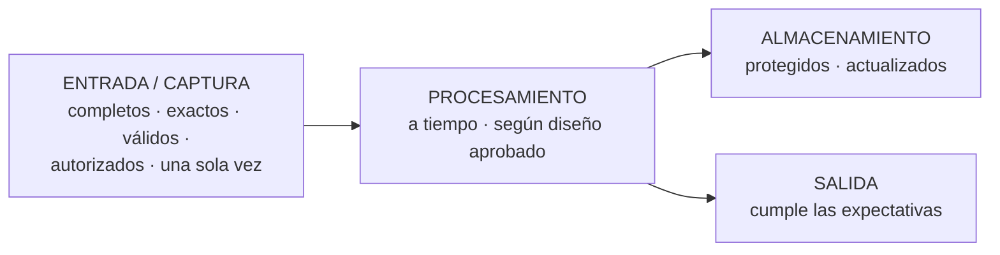

# Auditoría de sistemas de aplicación instalados

## i. Concepto
Auditoría de los sistemas de aplicación **ya instalados y en operación**, enfocada en identificar y evaluar sus **fortalezas y debilidades** y en verificar los **controles** sobre sus funciones.

Los componentes de los sistemas de aplicación instalados comprenden las funciones de **captura e ingreso** de datos, **procesamiento**, **almacenamiento** y **salida** de información. Sobre ellas hay que activar controles que intentan asegurar que:
- solo se ingresen datos **completos, exactos, válidos y autorizados (y por única vez)**;
- la **actualización** se haga en el momento que corresponde y con las mismas condiciones de seguridad;
- el **procesamiento** se realice **a tiempo** y según el **diseño aprobado**;
- los datos se mantengan **protegidos y actualizados**;
- las **salidas** cumplan las **expectativas** formuladas al definir el proyecto.

**En criollo:** acá se audita "el sistema que ya anda": que lo que entra sea correcto, que lo procese bien y que lo que sale sirva.

## ii. Funciones del auditor
- **Comprender a fondo cada aplicación** (documentación e investigación) para identificar sus **componentes significativos y el flujo de datos**; de ahí surgen las estrategias de prueba.
- **Evaluar los controles incorporados** para identificar **fortalezas y debilidades** y definir los **objetivos de control**.
- **Probar los controles** existentes con procedimientos de auditoría adecuados.
- **Evaluar el ambiente de control** a partir de los resultados de las pruebas.
- Analizar la **eficiencia y eficacia** de las operaciones, comparándolas con **estándares de programación** y considerando tecnología y procedimientos.
- Verificar el **grado de cumplimiento de los objetivos de la gerencia** formulados al definir el sistema.

> [!tip] Tipo de prueba
> En la clase se remarcó que a los sistemas instalados "se les hacen **pruebas sustantivas**: todo lo que procese información" (procesamiento en paralelo, cruce de datos) → [[Tipos de pruebas de auditoría]].

## iii. Síntesis de los elementos a auditar
- **Sistemas de entrada y captura** de datos.
- **Procesos y métodos de procesamiento** de datos.
- **Control de la salida.**

Ampliado (Extras del apunte): controles de **entrada, procesamiento, salida y archivos/base de datos**; integridad y exactitud de los datos; seguridad de las transacciones; cumplimiento de procedimientos; eficiencia; **controles de validación**; operaciones en distintos ambientes (centralizado, distribuido, en línea, batch); y auditorías por módulo (compras/recepción, cuentas a pagar, ventas, cobranzas, remuneraciones, inventarios, bienes de uso) → [[Otras áreas de auditoría (Extras del apunte)]].

**Cuestionario:** responde la **II.4** (área 2.b).

## 🔗 Relacionado
- [[Objetos y áreas de la auditoría de SI]] · [[Auditoría de sistemas de información]] (pistas de auditoría, excepciones y rechazos) · [[Evaluación de prestaciones]] (U3: el rendimiento del sistema como evidencia de eficiencia)
