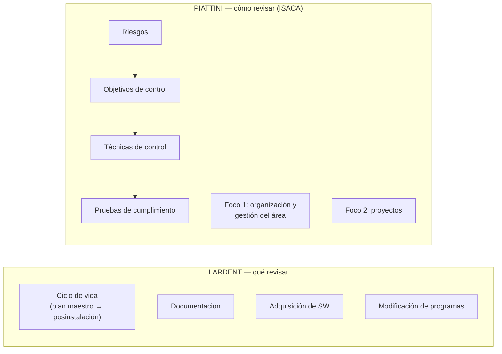

# Auditoría del desarrollo — Lardent vs Piattini & Del Peso (II.5)

| Criterio | **LARDENT** | **PIATTINI & DEL PESO** |
|---|---|---|
| **Objetivo** | **Identificar, analizar y evaluar** los requerimientos del usuario, los **riesgos**, las exposiciones y los **controles a incorporar** durante el desarrollo | **Comprobar la existencia** de procedimientos de control y **verificar su correcta definición y aplicación**, para determinar **deficiencias** y **riesgos asociados** |
| **Grado de estructuración** | **Propuestas generales**: indica **qué** actividades revisar, no **cómo** → **más flexible**; el auditor decide dónde poner el foco | **Muy estructurado**: indica **los pasos** a seguir; herramientas y **listas de verificación** por etapa |
| **Metodología** | Áreas de revisión con **puntos de control** para cada una | **ISACA**: riesgos → **objetivos de control** → **técnicas de control** → **pruebas de cumplimiento** |
| **Rol del auditor** | **Activo y asesor**: trabaja a la par del equipo y **ayuda a definir los puntos de control** y módulos/pistas de auditoría; quien luego audite debe ser **otra persona** | **Evaluador/verificador** del grado de cumplimiento de objetivos de control preestablecidos (la clase también lo describe como "más asesor", con una guía clara y ordenada — ver advertencia) |
| **Alcance** | **Cuatro niveles:** revisión del ciclo de vida (plan maestro, factibilidad, fases hasta la **posinstalación**), documentación, **adquisición** de software y **modificación** de programas | **Doble foco:** organización y gestión del **área de desarrollo** (8 objetivos de control, niveles A–G) + **proyectos** de desarrollo (aprobación, planificación y gestión; análisis, diseño, construcción, implantación). **No** incluye explotación, mantenimiento ni retiro |
| **Mirada** | **Institucional y organizacional**: productividad, **costos**, aspectos **normativos**, alineación con el plan maestro, justificación económica, riesgos contractuales con proveedores | **Técnica y de ingeniería de software**: rigor metodológico, **calidad** del desarrollo, gestión formal de proyectos (Métrica v3, normas ISO) |
| **Adaptación** | Flexible por naturaleza (clásicas o ágiles, "según aporten valor") | Los objetivos y niveles **no son un modelo cerrado**: se adaptan a cada organización y proyecto |
| **Fuente** | Lardent, capítulos sobre auditoría del desarrollo (el apunte cita "cap. 25") | Piattini & Del Peso, **cap. 12 "Auditoría del desarrollo"** |

> [!warning] Contradicciones y huecos en las fuentes
> - **Número de capítulo de Piattini:** los apuntes de clase y el *Complemento* dicen "**cap. 22**", pero el índice del libro (2.ª ed.) muestra **Capítulo 12. Auditoría del desarrollo** (12.4 organización y gestión del área; 12.5 auditoría de proyectos); el capítulo 22 corresponde a la auditoría en el **sector bancario**. Citá **cap. 12**.
> - **Métrica v3:** el apunte de clase dice que es "la cascada española, metodología de desarrollo **definida por Piattini** que deriva de normas ISO"; el *Complemento* solo dice que Piattini sigue "metodologías como Métrica v3 / normas ISO". Ninguna fuente de autor confirma que Piattini la haya definido: lo seguro es decir que su enfoque **se apoya en metodologías estructuradas (tipo Métrica v3) y normas ISO**.
> - **Rol del auditor en Piattini:** el *Complemento* lo presenta como "evaluador/verificador", y la clase dice que "Piattini ve al auditor más como una función asesora". La definición del apunte ("función auditora encargada de **comprobar** la existencia de procedimientos de control y **verificar** su definición y aplicación") respalda la idea de **verificación**.
> - El cuadro del *Complemento* **(fuente: Complemento a los apuntes — no es material de cátedra)** coincide en lo esencial con la comparación del apunte de clase (Lardent flexible/institucional vs Piattini estructurado/técnico).

## Conclusión sugerida para el final
Ambos persiguen lo mismo —que los sistemas se desarrollen con **controles adecuados** y según la **metodología**—, pero desde lugares distintos: **Lardent** es un **marco general y flexible**, institucional y de negocio, donde el auditor **asesora** para definir puntos de control (y luego otro audita); **Piattini** es un **método detallado** derivado de ISACA, técnico y orientado a la **calidad**, donde el auditor **verifica** el cumplimiento de objetivos de control mediante técnicas y pruebas. En la práctica se complementan: Lardent dice **qué** mirar (incluidas adquisición y modificaciones) y Piattini **cómo** medirlo.

**Cuestionario:** responde la **II.5**.

## 🔗 Relacionado
- [[Auditoría del desarrollo de sistemas]] · [[Tipos de pruebas de auditoría]] · [[Autores y modelos clave U6]]
