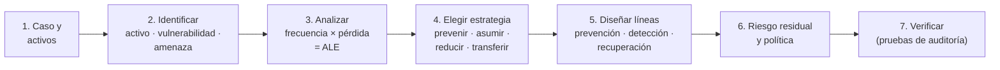

# Guía del laboratorio U6 — líneas de defensa sobre un análisis de riesgo

> [!info] Consigna oficial (temario)
> "**Diseño e implementación de esquemas de líneas preventivas, de detección y recuperación de accesos a recursos sobre la base de un análisis de riesgo para un caso de estudio.**"

Esta guía arma el trabajo **solo con las herramientas teóricas de la unidad**: identificación → análisis → manejo del riesgo (Robson) → controles por [[Líneas de defensa|líneas de defensa]] → [[Políticas de seguridad|políticas]] → verificación (auditoría). El ejemplo numérico es **inventado para practicar**.

## Paso 1 — Describir el caso y listar los activos
Usá las categorías de Robson: **hardware, software, datos e información, capacidad de procesamiento, personal, fondos** (y documentación, redes). Para cada activo anotá **dónde está** (ubicación del riesgo) y **quién accede**.

## Paso 2 — Identificar riesgos
Para cada activo, completá la oración del apunte: **"tengo este activo, con esta vulnerabilidad, que puede sufrir esta amenaza"**. Pasá la lista por la matriz de Robson para no olvidar nada:

| | Físico | Lógico |
|---|---|---|
| **Accidental** | fallas de equipos/energía, incendio, inundación | error de usuario, de programación, de configuración |
| **Deliberada** | robo, sabotaje | virus, piratería, fraude, hacking (¡incluido el **personal interno**!) |

## Paso 3 — Analizar el riesgo
- **Frecuencia = prob. de agresión × prob. de éxito** (usá escalas relativas: muy alta 90 %, alta 70 %, media 50 %, baja 20 %…).
- **Pérdida potencial** por ocurrencia: sumá **primarias y secundarias** (si no podés en pesos, usá ranking cualitativo).
- **Exposición anual (ALE) = pérdida por ocurrencia × ocurrencias por año** → [[Tabla de pérdida anual (ALE)]].

## Paso 4 — Elegir una estrategia por riesgo
Una sola estrategia por riesgo ([[Manejo del riesgo (4 estrategias)]]): **prevenir** (evitar la amenaza), **asumir** (pérdida tolerable), **reducir** (controles; solo si la baja en ALE supera el costo anual del control), **transferir** (seguro/contrato, para alto costo y baja probabilidad). Ordená los riesgos **de mayor a menor ALE** y tratá los **desastres potenciales** como prioridad alta.

## Paso 5 — Diseñar las líneas de defensa sobre el acceso a recursos
Para cada recurso crítico, completá la tabla. Pensá en **controles lógicos y físicos**, y en **generales y de aplicación**:

| Recurso | 1ª línea — PREVENCIÓN | 2ª línea — DETECCIÓN | 3ª línea — RECUPERACIÓN |
|---|---|---|---|
| Acceso lógico a la aplicación | Usuarios y contraseñas, **perfiles por rol** (política **prohibitiva**: lo no permitido está denegado), separación de funciones | **Registro de intentos fallidos**, logs de transacciones revisados por un tercero, alertas | Bloqueo y reseteo de cuentas, restauración de datos alterados desde backup, pistas de auditoría para reconstruir |
| Acceso a la red / servidor | Firewall (filtrado de puertos y orígenes), encriptación del canal, saludo/identificación de terminales | Monitoreo de tráfico y de carga, revisión de logs del firewall | Rutas alternativas, imagen del servidor, sitio de respaldo |
| Acceso físico a la sala | Cerraduras, tarjetas, ubicación lejos de áreas públicas y de sótanos, prohibido fumar | Detector de humo, cámaras, registro de ingresos | Extinción no contaminante, hardware alternativo, plan de contingencias |
| Datos | Clasificación de la información, encriptación de archivos, antivirus (monitoreo) | Escaneo antivirus, controles de integridad (totales de control) | **Backups off-site probados**, reinstalación de datos del período de inhabilitación |

## Paso 6 — Riesgo residual y política
- Estimá el **riesgo residual** (lo que queda tras los controles): ¿dónde hace falta más control? ¿algo quedó **sobrecontrolado**?
- Redactá la **política general** y las **políticas específicas** por activo/perfil; indicá si son **prohibitivas o permisivas**; cubrí **protección, valor, acceso y recuperación** de la información (Saunders). Las políticas son **1ª línea de defensa**.
- Si hay riesgo de desastre: esbozá el [[Plan de contingencias|plan de contingencias]] (tolerancia por aplicación, nivel de emergencia, sede/hardware alternativo, metodología de recuperación).

## Paso 7 — Verificar (mirada de auditor)
- **Pruebas de cumplimiento:** ¿la configuración real coincide con la política documentada? (revisar perfiles, reglas del firewall, actas de backup).
- **Pruebas sustantivas:** intentar un acceso no autorizado y ver si se **bloquea y registra**; restaurar un backup de prueba y comparar resultados.
- Documentar **hallazgos y recomendaciones** como en un [[Informe de auditoría|informe de auditoría]].

> [!example] Mini-caso para practicar (inventado)
> *Consultorio con turnos online y un servidor propio.*
> | Activo → vulnerabilidad → amenaza | Prob. agresión | Prob. éxito | Frecuencia | Pérdida por vez | ALE aprox. | Estrategia |
> |---|---|---|---|---|---|---|
> | BD de pacientes → contraseña débil del admin → acceso externo no autorizado | media 50 % | media 50 % | 25 % (≈ 1 cada 4 años) | 2.000.000 pesos (multas, reputación) | 500.000 pesos | **Reducir** (MFA, perfiles, logs, encriptación) |
> | Servidor → sin UPS → cortes de energía | — | — | ≈ 50 veces/año (dato histórico) | 5.000 pesos | 250.000 pesos | **Reducir** (UPS) / **detectar** (alertas) |
> | Sala → edificio inundable → inundación | baja 20 % | media 50 % | 10 % (≈ 1 cada 10 años) | 8.000.000 pesos | 800.000 pesos | **Transferir** (seguro) + **recuperar** (backup off-site, sitio alternativo) |
> | PC de recepción → uso personal → virus | — | — | ≈ 10 veces/año (dato histórico) | 2.000 pesos | 20.000 pesos | **Prevenir** barato (antivirus + capacitación) |
>
> *Para eventos frecuentes conviene usar la cantidad de ocurrencias por año (evidencia empírica); para los raros, el producto de probabilidades (cálculo razonado), como hace Robson.*
>
> Lectura: la inundación es **baja frecuencia / alto costo** → seguro; los cortes de energía son **alta frecuencia / bajo costo** → controles; todo control cuyo costo anual supere su ALE no se justifica (salvo exigencia legal).

> [!tip] Pregunta de final relacionada
> V/F: "*iptables permite la configuración de un firewall por hardware*" → **Falso**: iptables configura un **firewall por software** (filtrado de paquetes del kernel Linux). Es una herramienta típica de la **1ª línea** (prevención) sobre el acceso a recursos de red.

## 🔗 Relacionado
- [[Administración del riesgo]] · [[Líneas de defensa]] · [[Controles y contramedidas]] · [[Políticas de seguridad]] · [[Tipos de pruebas de auditoría]]
