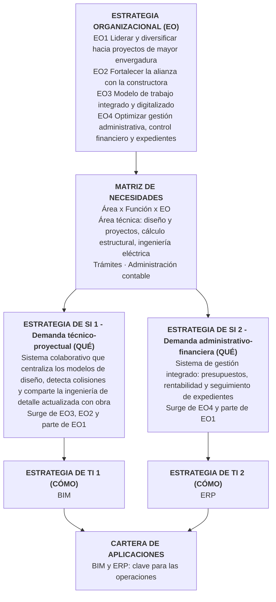

# 📝 Parcial ASI — Enunciado y resolución

> [!info] Cómo leer esta nota
> Cada ejercicio tiene el **enunciado** y la **respuesta**, con el apunte del vault que la respalda. Las partes i a iv se resuelven con la teoría de la **Unidad 1**; la parte v (**validación del TPI**) se resuelve con el caso **Solara – Estudio de Arquitectura y Desarrollos** (Resistencia, Chaco) del TPI del grupo.
> Donde la respuesta tiene un margen de interpretación se aclara en un cuadro **⚠️**.

| Parte | Tema | Puntos |
|---|---|---|
| i | Gráfico de la metodología de alineamiento | 12 |
| ii | Verdadero / Falso (ubicación de los SI) | 5 |
| iii | Opción correcta (beneficio genérico) | 5 |
| iv | Opción múltiple (9 preguntas × 4) | 36 |
| v | Validación del TPI, 1.ª parte | 42 |

---

## i) Gráfico de la metodología de alineamiento (12 ptos)

> [!question] Enunciado
> Complete el gráfico sobre la metodología de alineamiento de los SI/TI. Indique el **nombre correcto de cada fase**, **2 aspectos centrales** de cada fase y la **salida** que provee cada fase (3 ptos por respuesta correcta y completa; si no, 0).
> El gráfico tiene **4 bloques**: una flecha con el nombre de la fase, un recuadro con los aspectos y una barra con la salida, unidos por flechas hacia abajo.

> [!success] Respuesta
> Es el **procedimiento de alineamiento del Plan de TI/SI** (Andreu, Ricart y Valor, cap. 5). Detalle en [[Procedimiento de alineamiento (4 fases)]].

```mermaid
flowchart TD
    F1["<b>FASE I - Presentación y compromiso del equipo</b><br/>1. La alta dirección decide explícitamente elaborar el Plan y se compromete a participar (Comité de TI/SI)<br/>2. Se constituye el equipo de trabajo (grupo base, áreas de análisis) y se presenta el proyecto a la organización"]
    S1(["SALIDA: equipo de trabajo definitivo constituido y proyecto presentado a toda la organización"])
    F2["<b>FASE II - Descripción de la situación actual</b><br/>1. Funciones y procesos de negocio por área + descripción de los sistemas existentes (datos y procesos)<br/>2. Crítica técnica y de negocio, validada por los subdirectores generales"]
    S2(["SALIDA: informe sobre los sistemas existentes (descripción y crítica validadas)"])
    F3["<b>FASE III - Elaboración del Plan de TI/SI</b><br/>1. Necesidades de información (matriz) y estructura del SI emergente<br/>2. Propuestas alternativas (3 o 4 escenarios) y aprobación por el Comité de TI/SI"]
    S3(["SALIDA: Plan de TI/SI definitivo, consensuado y aprobado (3 a 5 años)"])
    F4["<b>FASE IV - Programación de actividades</b><br/>1. Lista de proyectos del Plan aprobado y asignación de recursos (DOP)<br/>2. Calendario detallado del primer año e inclusión en el presupuesto del período siguiente"]
    S4(["SALIDA: programa de actividades: calendario y presupuesto del primer año + plan de evaluación y revisión"])
    F1 --> S1 --> F2 --> S2 --> F3 --> S3 --> F4 --> S4
```

| Fase | Nombre | 2 aspectos centrales | Salida |
|---|---|---|---|
| **I** | **Presentación y compromiso del equipo** | **1)** Decisión explícita de la **alta dirección** de elaborar el Plan y compromiso de participar (Comité de TI/SI). **2)** Formación del **grupo base** y del **equipo de trabajo definitivo** y presentación del proyecto: el Plan es **de toda la organización** | **Equipo de trabajo definitivo** constituido y presentado |
| **II** | **Descripción de la situación actual** | **1)** Descripción de **funciones y procesos de negocio** por área y de los **sistemas existentes** (datos y procesos). **2)** **Crítica doble**: **de negocio** (soporte, puntos fuertes y débiles) y **técnica** (tecnología, rendimientos, interrelaciones), **validada** por los subdirectores generales | **Informe sobre los sistemas existentes** (situación actual validada) |
| **III** | **Elaboración del Plan de TI/SI** | **1)** **Necesidades de información** por áreas, funciones y procesos (cruce con la estrategia = **matriz**) y **estructura del SI emergente**. **2)** **Propuestas alternativas** (3 o 4 escenarios, con criterios generales y estratégicos) y **aprobación** por el Comité: el **coste** lo estima el personal técnico y el **beneficio** el personal de negocio | **Plan de TI/SI definitivo aprobado**, plan consensuado a **3-5 años** |
| **IV** | **Programación de actividades** | **1)** El DOP arma la **lista de proyectos** y propone la **asignación de recursos**. **2)** **Calendario detallado del primer año**, **inclusión en el presupuesto** del período siguiente y **plan de evaluación y revisión** | **Programa de actividades**: calendario y presupuesto del **primer año** |

> [!tip] Mnemotecnia
> **I** = ¿quiénes lo hacemos? · **II** = ¿dónde estoy? · **III** = ¿a dónde quiero ir? · **IV** = ¿cuándo y con qué recursos? *(glosa de apuntes, no del libro)*.

> [!warning] ⚠️ Las "salidas" no están rotuladas como tal en el libro
> Andreu describe los **pasos** de cada fase (I.1 a IV.3) y no una etiqueta "salida". Las salidas de arriba son el **producto final de cada fase**: I.4 equipo definitivo, II.4 informe de sistemas existentes, III.8 plan definitivo, IV.1-IV.2 calendario y presupuesto. Si la cátedra usa otra redacción, el sentido es el mismo.

---

## ii) Verdadero o Falso (5 ptos)

> [!question] Enunciado
> *"Se pueden implementar en forma conjunta aunque con aspectos parciales los distintos tipos de ubicación de los SI. Todo depende de las necesidades empresariales y de la complejidad tecnológica que la organización tenga."* — V / F

> [!success] Respuesta: **VERDADERO**
> Robson (T4, cap. 9): **cualquiera de las tres ubicaciones es posible** (centralizada, descentralizada, delegada) y, por lo general, las empresas **agregan facetas de cada categoría**, según lo permitan las **complejidades tecnológicas** y las **necesidades del negocio**. Estos **sistemas mixtos** parecen ser la "norma" y son lo que Edwards et al. llaman **enfoque federal**. Ver [[Ubicación de los IS]] y [[Centralizados vs no centralizados]].

---

## iii) Seleccione la opción correcta (5 ptos)

> [!question] Enunciado
> Sistemas **predictivos basados en IA** para la cadena de suministro (SCM): pasan de un modelo **reactivo** a uno **proactivo**; usan aprendizaje automático y análisis de datos para **anticipar la demanda, optimizar el inventario y prevenir disrupciones**, reduciendo tiempos de entrega. Este SI/TI reporta un beneficio genérico que es: **a.** Eficiencia · **b.** Efectividad · **c.** Competitividad

> [!success] Respuesta: **b. Efectividad**
> Robson (T3, cap. 7, Fig. 7.17) distingue tres beneficios genéricos: **eficiencia** (ahorro de costos, "hacer bien las cosas": automatizar lo existente), **efectividad** (mayor RoA, "hacer lo que está bien": **informar y apoyar decisiones**) y **competitividad** (crecimiento del negocio, avance estratégico).
> Un sistema que **anticipa la demanda, recomienda cuánto inventario tener y previene disrupciones** no automatiza una tarea para gastar menos: **mejora la calidad de las decisiones** (qué comprar, cuánto, cuándo). Es el mismo tipo de valor que el libro asigna a un **DSS**: efectividad, percibida sobre todo por el **nivel táctico**. Ver [[Beneficios de los IS]] y [[DSS e intervalos de decisión]].

> [!warning] ⚠️ Por qué no las otras
> - **Eficiencia** sería la lectura si el enunciado hablara solo de **reducir costos** o **automatizar** un proceso. Acá el verbo central es **anticipar / prevenir** (decidir mejor), y "reducir tiempos de entrega" es una consecuencia.
> - **Competitividad** exigiría que el beneficio fuera **crecimiento del negocio o ventaja sobre competidores** (intangible, de nivel estratégico). El enunciado no menciona nada de eso.
> - La frase "transforman de reactivo a proactivo" puede tentar a marcar *competitividad* (era E3 "transformar"), pero el criterio del libro es el **tipo de valor**, que acá es **mejor decisión** = efectividad.

---

## iv) Opción correcta (36 ptos, 4 c/u)

> [!info] Nota
> Las preguntas **2 y 9 son idénticas** en el enunciado (mismo texto y mismas opciones). Se responden igual.

### 1) Intervalo de decisión (Andreu et al.) → **D**
> **D.** Una parte del proceso de información que **no es mecanizable** y requiere la intervención de un ser humano.

Es la definición del libro (parte del SI que por su naturaleza no es mecanizable, al ser necesaria la intervención del decisor). La TI no lo automatiza: lo **ayuda** con un **DSS**. Ver [[DSS e intervalos de decisión]].

### 2) y 9) Análisis coste-beneficio en la Fase III → **A**
> **A.** El **coste** lo estima el **personal técnico (SI)** y el **beneficio** lo evalúa el **personal de negocio**.

Es una característica esencial del procedimiento: costo y beneficio en **dos fases y por personas distintas**. Ver [[Procedimiento de alineamiento (4 fases)]].

### 3) Las TICs contribuyen a la cadena de valor → **F. Todas las anteriores**
Los SI/TI son **infraestructura de la empresa** (actividad de soporte): **recopilan, distribuyen y coordinan** información entre todas las actividades (**apoyo a los procesos internos**, C), lo que permite **operar y decidir** (B), con más **eficacia y eficiencia** (D) y, en definitiva, **contribuye al margen**: ingresos y utilidades (A). Todas las afirmaciones son correctas y no hay una que excluya a las demás. Ver [[El SI en la cadena de valor]] y [[Tecnologías de la Información (rol)]].

> [!warning] ⚠️ Pregunta con margen
> Si la cátedra toma la lectura estricta de Andreu (las TI/SI **no generan ingresos por sí mismas**, son **soporte**), A quedaría descartada y la respuesta defendible sería **C. Proporcionando apoyo a los procesos internos**. Mi respuesta es **F** porque la cadena de valor de Porter converge en el **margen** y los SI/TI contribuyen a él.

### 4) Distinción SI / TI (Edwards et al.) → **A**
> **A.** El **SI** se ocupa de la **concepción y el propósito de negocio**; las **TI**, de la **infraestructura y ejecución técnica**.

Estrategia de SI = **QUÉ** (necesidades, **demanda**); estrategia de TI = **CÓMO** (**oferta**). Primero la demanda, después la oferta. Ver [[Estrategia de SI vs Estrategia de TI]].

### 5) Objetivo principal del SI (Andreu, Ricart y Valor) → **D**
> **D.** **Soportar las funciones y procesos de negocio de acuerdo con la estrategia** de la empresa.

Es el cierre de la definición formal de SI: define el **para qué**, no la tecnología. Ver [[Sistema de Información (definición)]].

### 6) Ubicación del SI en la cadena de valor de Porter → **C**
> **C.** Forma parte de la **infraestructura de la empresa** y actúa como **nexo de coordinación** entre todas las actividades.

Ver [[El SI en la cadena de valor]].

### 7) Subsistema "circunscrito" que pasa a formar parte del SI "básico" → **C**
> **C.** Cuando **varios subsistemas se solapan** y empiezan a **coordinar o influenciar notablemente a varias actividades**.

Es la Fig. 2.2-c de Andreu: si los subsistemas particulares se solapan de modo que varias actividades se coordinan a través de ellos, su conjunto es **parte del SI básico**. Ver [[El SI en la cadena de valor]].

### 8) Criterios estratégicos en la matriz de planificación → **B**
> **B.** **Hacia el final del proceso**, para evitar prescindir prematuramente de necesidades que podrían ser relevantes.

Las **filas** (funciones y procesos) entran desde el principio; las **columnas** (criterios estratégicos) entran tarde, porque aplicar el "filtro estratégico" demasiado pronto lleva a un SI **incompleto e incoherente**. Ver [[Matriz de necesidades]].

### Resumen de respuestas

| 1 | 2 | 3 | 4 | 5 | 6 | 7 | 8 | 9 |
|---|---|---|---|---|---|---|---|---|
| **D** | **A** | **F** | **A** | **D** | **C** | **C** | **B** | **A** |

---

## v) Validación del TPI — 1.ª parte (42 ptos)

> [!question] Enunciado
> 1. Elabore el **esquema sintético de alineamiento** (Edwards et al.) para el **caso en estudio de su grupo**.
> 2. Clasifique y fundamente la **ubicación de la aplicación resultante en la cartera de aplicaciones**.
> 3. ¿Qué **tipo de inversión** es de acuerdo con el **impacto buscado**? Fundamentar.

> [!abstract] Caso del grupo (resumen del TPI)
> **Solara – Estudio de Arquitectura y Desarrollos** (Resistencia, Chaco): 12 profesionales, ciclo completo del proyecto (anteproyecto → proyecto ejecutivo → ingeniería de detalle → dirección técnica → post-entrega) más un área de apoyo administrativa y de trámites. Hoy trabaja con **AutoCAD**, **Lumion**, **Google Drive** y **planillas de Excel**, sin sistemas integrados y sin "única fuente de verdad". El TPI define **4 estrategias organizacionales (EO)**, **2 estrategias de SI** y **2 estrategias de TI**.

### 1. Esquema sintético de alineamiento

El esquema de Edwards baja de lo **general a lo particular**: la **estrategia empresarial** define el **QUÉ** (necesidades de información → **estrategia de SI**, la demanda) y de ahí se deduce el **CÓMO** (**estrategia de TI**, la oferta), que termina en una **cartera de aplicaciones**. Ver [[Alineamiento E.O. – E.SI-TI (esquema general)]] y [[Contexto de la estrategia SI-TI (Edwards)]].

| Nivel | Contenido en Solara | Pregunta que responde |
|---|---|---|
| **Estrategia organizacional** | EO1 liderazgo regional y proyectos de mayor envergadura · EO2 alianza con la constructora · EO3 trabajo integrado y digitalizado · EO4 gestión administrativa y control centralizado | ¿Hacia dónde va la empresa? |
| **Matriz de necesidades** | Necesidades de información por **área** (técnica, trámites, administración contable), **función** y **EO** | ¿Qué información necesita cada función para cumplir cada EO? |
| **Estrategia de SI (demanda, QUÉ)** | **SI 1:** sistema colaborativo visual, con modelos centralizados y detección automática de interferencias. **SI 2:** sistema de gestión integrado (presupuestos, rentabilidad, expedientes) | ¿Qué sistemas hacen falta? |
| **Estrategia de TI (oferta, CÓMO)** | **BIM** para SI 1 · **ERP** para SI 2 | ¿Con qué tecnología se satisface? |
| **Cartera de aplicaciones** | BIM y ERP, clasificados según su contribución al éxito del negocio | ¿Dónde invertir recursos y esfuerzo? |

**Correspondencia EO ↔ SI ↔ TI**

| Estrategia de SI | EO que la originan | Área principal | Estrategia de TI |
|---|---|---|---|
| **SI 1** — Demanda técnico-proyectual | EO3, EO2 y parte de EO1 (parte técnica) | Área técnica | **BIM** |
| **SI 2** — Demanda administrativo-financiera | EO4 y parte de EO1 (parte administrativa) | Trámites y administración contable | **ERP** |

> [!tip] Qué decir al exponerlo
> **Primero la demanda, después la oferta:** las necesidades de información de la matriz dan las **estrategias de SI**, y recién de ellas se deduce la tecnología (BIM, ERP). Así se evita elegir la herramienta por moda y queda cada inversión atada a una estrategia organizacional.

### 2. Ubicación en la cartera de aplicaciones (McFarlan / Edwards)

La cartera clasifica cada aplicación según su **contribución presente y futura** al éxito del negocio. Ver [[Cartera de aplicaciones (McFarlan)]].

| | **Críticas** | **Importantes / valiosas** |
|---|---|---|
| **Futuro** | **Estratégicas** — críticas para ejecutar la **estrategia futura** | **De alto potencial** — pueden ser importantes para el éxito futuro |
| **Presente** | ✅ **Clave para las operaciones** — de ellas **depende** el éxito actual → **BIM · ERP** | **De apoyo** — valiosas pero **no críticas** |

> [!success] Respuesta: **BIM y ERP → cuadrante "Clave para las operaciones"**
> Son aplicaciones **de las que depende el éxito de la organización**, críticas para el núcleo del negocio ([[Aplicaciones clave para las operaciones]]).

| | **BIM** | **ERP** |
|---|---|---|
| **Dónde opera** | Área **técnica**: planificar, crear y controlar los proyectos en **todas sus fases** | **Administración, trámites y dirección**: presupuestos, facturación, cobros, pagos y expedientes |
| **Por qué es "clave"** | Es el sistema esencial para el **servicio que Solara vende** (proyecto, ingeniería de detalle, cómputos); sin él no hay **continuidad operativa** | Maneja el **dinero y los números del día a día**; sin él administración no controla flujo de caja ni honorarios y trámites no tiene fondos para tasas |
| **Fuerza motriz (Tabla 6.3 de Edwards)** | **Mejorar el rendimiento** de actividades existentes (menos errores y retrabajos, cómputo automático) y **evitar una desventaja** (el estándar del sector ya usa BIM) | **Integrar sistemas y datos** (hoy en planillas desconectadas) y evitar información errónea y duplicación de tareas |
| **Por qué no las otras** | **Apoyo:** no es "valiosa pero no crítica", el estudio depende de ella. **Alto potencial:** BIM no es una idea a explorar: es una tecnología **probada y estándar**. **Estratégica:** el diferencial de Solara está en la integración técnica-ingeniería y la alianza, no en tener BIM | **Apoyo:** no es accesoria, sostiene la operación. **Estratégica:** no es la que da la ventaja competitiva frente a otros estudios |
| **Estrategia genérica de gestión (Parsons)** | **Monopolio:** un único sistema estandarizado, con control central, para que nada falle | **Monopolio:** control total y centralizado, un solo sistema para garantizar fiabilidad y evitar riesgos |

Ver [[Monopolio]] y [[Estrategias genéricas de gestión (Parsons)]]: el **monopolio** es el cuadrante ideal de las aplicaciones clave (reduce riesgos, integra funciones y datos).

> [!warning] ⚠️ Punto defendible a tener preparado
> BIM podría discutirse como **estratégica** porque habilita **EO1 y EO3** (proyectos de mayor envergadura, trabajo digitalizado). La postura del TPI (**clave**) se sostiene porque, según el propio diagnóstico, BIM es **estándar de la industria**: hoy es una **necesidad para operar** más que una fuente de ventaja distintiva. Si el docente pregunta, la respuesta es: *"clave hoy, y puede subir a estratégica si el estudio explota el modelo para captar obras de gran escala"* (ver migración entre cuadrantes en [[Cartera de aplicaciones (McFarlan)]]).

### 3. Tipo de inversión según el impacto buscado (Robson)

Según el **impacto buscado**, las inversiones en IS se dividen en **valor operacional** y **valor estratégico**. Ver [[Clasificación de las inversiones en IS]].

> [!success] Respuesta: **VALOR OPERACIONAL** (tanto BIM como ERP)

**Fundamento (Robson, T3, cap. 7):** el valor operacional corresponde a proyectos de **mejora de la productividad en el proceso de transacción**, con perspectivas de **ganancia a corto plazo**, generalmente para **reducir costos** en los procesos del negocio, y su impacto es **inmediato y medible** sobre las operaciones diarias.

| | **BIM** | **ERP** |
|---|---|---|
| **Qué mejora** | Cómo se **hace** el trabajo técnico del día a día | Cómo se hace la **gestión administrativa y de trámites** del día a día |
| **Impacto inmediato y medible** | **Menos errores y retrabajos** (re-presupuestaciones por imprevistos), **detección automática de colisiones**, cómputo métrico y documentación de detalle más rápidos | **Menos tiempos muertos y errores de cálculo**, fin de las **planillas manuales desconectadas**, seguimiento de cobros, pagos y expedientes con alertas |
| **Beneficio genérico** | **Eficiencia** (ahorro de costos), percibida a nivel **operacional** | **Eficiencia**, percibida a nivel **operacional** (y algo de efectividad a nivel táctico por el control de rentabilidad) |
| **Justificación** | Técnicas "duras": costo-beneficio (retrabajos evitados), ROI, payback | Técnicas "duras": horas administrativas ahorradas, errores evitados |

**Por qué no es de valor estratégico:** la inversión estratégica busca **aumentar el potencial de generar ingresos** con horizonte de **largo plazo**, con valor **directo pero muy difícil de cuantificar**. Acá el beneficio buscado es **productividad y reducción de errores en procesos existentes**, que es **cuantificable en el corto plazo**. Aunque ambos sistemas habilitan la estrategia de crecimiento (EO1), el **impacto directo** que se busca es sobre las operaciones, no un nuevo modelo de ingresos. *(En el esquema del TPI, la fila "Valor estratégico" queda vacía: es coherente con esta lectura.)*

> [!note] Complemento: "según la necesidad de la inversión"
> No lo pide el enunciado, pero el TPI también lo clasifica y conviene tenerlo a mano. **BIM = de umbral**: es lo que hay que hacer para operar en la industria (estándar del sector), rendimiento difícil de identificar, inversión efectivamente obligatoria. **ERP**: el TPI lo marca como umbral, pero encaja mejor como **de infraestructura**, porque **integra información de varias áreas** (administración, trámites y dirección), no genera beneficios directos propios y es base de otras mejoras (el propio TPI lo ubica en la **infraestructura de la empresa** según Porter). Conviene revisar ese punto en el documento del TPI.

> [!warning] ⚠️ Inconsistencias del TPI para corregir antes de entregar
> - En la sección **Tipos de Inversiones** del TPI aparecen signos de pregunta (`BIM?`, `ERP?`) y dos párrafos separados sobre BIM (umbral y valor operacional). La clasificación **según el impacto** y **según la necesidad** son dos ejes distintos: un mismo sistema puede ser **valor operacional (impacto)** y **umbral (necesidad)** a la vez, sin contradicción. Conviene redactarlo así.
> - La tabla de **Tipos de Beneficios** quedó con las celdas desordenadas (ERP aparece en más de una fila). Definir una sola celda por sistema, con su nivel organizacional.
> - En la Conclusión se dice que las estrategias genéricas **actuales** son de **Mercado Libre** (cada usuario usa la herramienta que prefiere), y las **propuestas** son de **Monopolio**. Está bien, pero hay que dejar explícito que es el **paso de una a otra** lo que se propone.

---

## 🔗 Relacionado
- [[Procedimiento de alineamiento (4 fases)]] · [[Grupos de trabajo del plan]] · [[Matriz de necesidades]]
- [[Cartera de aplicaciones (McFarlan)]] · [[Estrategias genéricas de gestión (Parsons)]]
- [[Beneficios de los IS]] · [[Clasificación de las inversiones en IS]]
- [[Ubicación de los IS]] · [[DSS e intervalos de decisión]] · [[El SI en la cadena de valor]]
